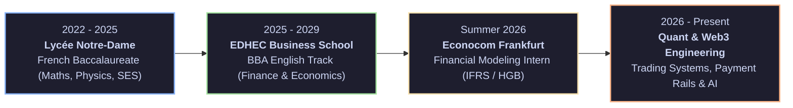

# Philippe Pinto De Silva -- Winnefeld

**BBA Student @ [EDHEC Business School](https://www.edhec.edu) (English Track)**  
*Quantitative Finance & Algorithmic Trading | Web3 & Payments | Autonomous AI Orchestration*

  <a href="#-featured-projects">Featured Projects</a> •
  <a href="#-technical-stack">Technical Stack</a> •
  <a href="#-experience--education">Experience & Education</a> •
  <a href="#-contact--links">Contact</a>

---

## 📌 About Me

I am a trilingual finance and software engineering student at **EDHEC Business School** (Lille, France), passionate about the intersection of **quantitative finance**, **crypto infrastructure**, and **autonomous agent systems**.

- 📈 **Quantitative Trading**: Designing ML-augmented algorithmic strategies (Freqtrade, FreqAI, LightGBM) on high-frequency and multi-timeframe crypto/equity markets.
- 💳 **Web3 & Infrastructure**: Architecting resilient payment gateways, chain listeners, and automated non-custodial settlement pipelines on EVM networks (Base, Ethereum).
- 🤖 **AI & Agent Orchestration**: Engineering multi-agent autonomous coordination loops, quota-aware failovers, and LLM automation tools.
- 📊 **Corporate Finance & Accounting**: Experienced in IFRS and German GAAP (HGB) financial modeling and conversion automation (internship experience at **Econocom Frankfurt**).

---

## 🚀 Featured Projects

<table width="100%">
<tr>
<td width="50%" valign="top">

### 📈 [freqtrade-lightgbm-strategy](https://github.com/Philippeh5/freqtrade-lightgbm-strategy)
**Algorithmic Trading Bot & Machine Learning Prediction Engine**
* Automated trading strategy using **Freqtrade**, **FreqAI**, and **LightGBM** regressor models for multi-timeframe price target forecasting.
* Custom feature engineering pipeline (OHLCV indicators, order flow proxies, volatility bands).
* Dynamic position sizing, trailing stop-losses, and automated walk-forward backtesting.
* **Stack**: `Python 3.11`, `Freqtrade`, `LightGBM`, `Scikit-learn`, `Pandas`, `NumPy`

</td>
<td width="50%" valign="top">

### 💳 [crypto-payment-gateway](https://github.com/Philippeh5/crypto-payment-gateway)
**Production-Ready EVM & Base USDC Payment & Settlement Infrastructure**
* High-throughput chain-watcher tracking on-chain deposits in real-time via WebSocket/RPC.
* Deterministic BIP-44 HD wallet address derivation for per-user deposit segregation.
* Deep reorg protection, multi-confirmation crediting, and automated hot-wallet withdrawal broadcast.
* **Stack**: `TypeScript`, `Node.js`, `Ethers.js / Viem`, `PostgreSQL / Supabase`, `Docker`

</td>
</tr>
<tr>
<td width="50%" valign="top">

### 📊 [automated-ifrs-hgb-converter](https://github.com/Philippeh5/automated-ifrs-hgb-converter)
**Corporate Finance Automation: IFRS to German GAAP (HGB §275)**
* Automated financial reporting pipeline converting P&L and Balance Sheet indicators from IFRS to German GAAP (Handelsgesetzbuch).
* Rules engine handling leasing assets (IFRS 16 capitalization vs. HGB off-balance rental), revenue recognition, and pension provisions.
* Automated reconciliation reports with audit trails for corporate accounting teams.
* **Stack**: `Python`, `Pandas`, `OpenPyXL`, `Pydantic`

</td>
<td width="50%" valign="top">

### 🤖 [ai-agent-workflows](https://github.com/Philippeh5/ai-agent-workflows)
**Autonomous Multi-Agent Orchestration & Quota-Aware Routing**
* Scalable multi-agent system executing specialized workflows (code generation, market analysis, review).
* Dynamic fallback router preventing downtime across LLM providers during rate-limits and quota depletion.
* Persistent state management and event-driven execution framework.
* **Stack**: `Python / TypeScript`, `FastAPI`, `Tailscale`, `Paseo`, `Claude / OpenAI API`

</td>
</tr>
</table>

---

## 🛠️ Technical Stack

| Domain | Technologies & Tools |
| :--- | :--- |
| **Languages** | Python, TypeScript, JavaScript, SQL, C/C++, HTML5/CSS3 |
| **Quant & Data Science** | Freqtrade, FreqAI, LightGBM, Pandas, NumPy, Scikit-learn, TA-Lib |
| **Web3 & Blockchain** | EVM (Base, Ethereum), Ethers.js, Viem, WebSockets, RPC, HD Wallets (BIP-32/44) |
| **Backend & Databases** | Node.js, Express, FastAPI, PostgreSQL, Supabase, Redis |
| **Cloud & DevOps** | Docker, Docker Compose, Linux (Ubuntu/Debian), Git, GitHub Actions, Tailscale |
| **Finance & Accounting** | IFRS Standards, German GAAP (HGB), Financial Modeling, Valuation, Advanced Excel |

---

## 📜 Experience & Education

### 🎓 Education
- **EDHEC Business School** (Lille, France) — *BBA English Track* (2025 – 2029)
  - Focus: Quantitative Finance, Corporate Finance, Financial Accounting, Economics.
- **Lycée Notre-Dame de Bellegarde** (Neuville-sur-Saône) — *French Baccalaureate* (2022 – 2025)
  - Specialisms: Mathematics, Physics-Chemistry, Economics & Social Sciences (Honors).

### 💼 Experience
- **Econocom** (Frankfurt am Main, Germany) — *Financial Modeling & Accounting Intern* (May 2026 – July 2026)
  - Engineered an automated financial forecasting model converting P&L indicators from IFRS to German GAAP (HGB).
  - Streamlined data extraction and consolidation across leasing operations in a bilingual (German/English) environment.

### 🌐 Languages
- **French**: Native
- **German**: Native (bilingual proficiency)
- **English**: Fluent — **Cambridge English C1 Advanced**

---

## 📊 GitHub Analytics

  
  

---

## 📫 Contact & Links

